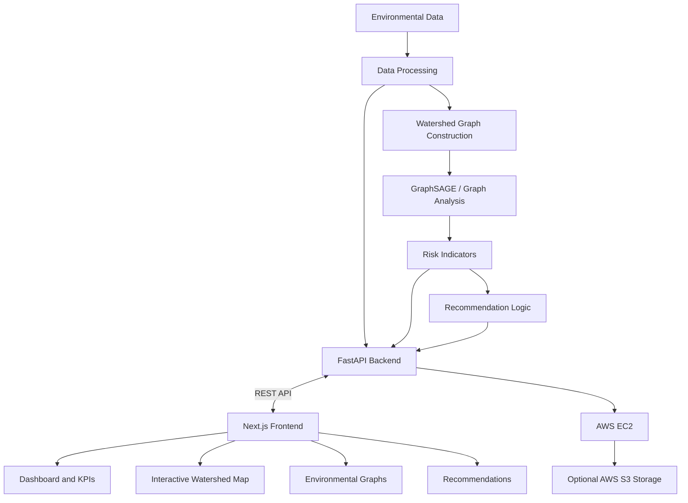

# 🌊 CASCADE — Drought Intelligence Engine

### Connecting watershed data with AI for smarter drought monitoring and climate-resilient decision-making.

<p align="center">
  
</p>

**CASCADE** is an AI-powered drought intelligence platform designed to help monitor watershed health, identify vulnerable regions, and support informed water and agricultural resource management.

By combining environmental indicators, graph-based machine learning, interactive watershed visualization, and actionable recommendations, CASCADE aims to transform fragmented environmental observations into meaningful, connected insights.

> **Monitor the watershed. Understand the connections. Prioritize the response.**

---

## ✨ Key Features

- **🗺️ Interactive Watershed Visualization** — Explore connected watershed nodes and understand their relationships through a visual basin interface.
- **📊 Environmental Dashboard** — View watershed health indicators, node classifications, and key monitoring metrics in one place.
- **📈 Environmental Graphs** — Visualize rainfall, soil moisture, and water-level measurements to understand changing conditions.
- **🧠 Graph-Based Intelligence** — Use a GraphSAGE-oriented approach to analyze relationships between connected environmental locations.
- **💡 AI-Assisted Recommendations** — Organize suggested actions across water conservation, agriculture, and environmental monitoring.
- **🚨 Risk Identification** — Highlight potentially vulnerable locations and help prioritize areas that may require attention.
- **☁️ Cloud-Hosted Backend** — Connect the web application to backend services deployed using AWS infrastructure.

## 📸 Screenshots

### Dashboard


### Watershed Visualization and Environmental Graphs
<p align="center">
  
  
</p>

### Recommendations


*Add your actual application screenshots using the filenames above. You can also include a landing-page screenshot at `docs/screenshots/landing-page.png`.*

---

## 🏗️ System Architecture

CASCADE follows a frontend–backend architecture in which the web dashboard communicates with backend services through REST APIs. The analytics layer processes available environmental information and connects it to watershed-level visualization and recommendations.



### Architecture Components

- **Frontend:** Presents watershed information through interactive maps, dashboard metrics, environmental graphs, and recommendation views.
- **Backend API:** FastAPI handles communication between the frontend and backend functionality.
- **Data Processing:** Structures environmental measurements and prepares the information required for analysis.
- **Graph Intelligence:** GraphSAGE can learn representations of connected watershed nodes using node features and graph relationships.
- **Recommendation Layer:** Organizes relevant actions based on available indicators and configured recommendation logic.
- **Cloud Infrastructure:** AWS EC2 hosts the backend service; AWS S3 can support object storage where configured.

*The diagram illustrates the intended system design. Actual data flow depends on the services, endpoints, and model components enabled in the deployment.*

---

## 🔄 Workflow

CASCADE is designed around the following workflow:

1. **Data Collection** — Obtain available environmental measurements, such as rainfall, soil moisture, and water-level observations.
2. **Data Processing** — Organize and prepare measurements for analysis, accounting for available features and missing values.
3. **Watershed Graph Construction** — Represent relevant locations as nodes and their relationships as edges.
4. **Graph-Based Analysis** — Apply graph analysis and the configured GraphSAGE model to investigate patterns across connected locations.
5. **Risk Assessment** — Present available environmental indicators and risk classifications for monitored areas.
6. **Recommendation Generation** — Provide categorized suggestions for water management, agricultural practices, and further monitoring.
7. **Visualization** — Display the resulting information through the dashboard, graphs, watershed map, and recommendations interface.

The quality of the resulting insights depends on data availability, graph construction, model validation, and the backend components configured for the deployment.

---

## ⚙️ Tech Stack

| Technology | Purpose |
|---|---|
| Next.js | Frontend application and routing |
| React | Interactive user interface |
| Tailwind CSS | Styling and responsive layouts |
| Python | Backend and data-processing logic |
| FastAPI | REST API services |
| PyTorch / PyTorch Geometric | Graph-based machine-learning tooling |
| GraphSAGE | Graph representation learning approach |
| AWS EC2 | Backend hosting |
| AWS S3 | Object storage, where configured |
| Vercel | Frontend deployment |
| Git & GitHub | Version control and collaboration |

---

## 🚀 Getting Started

### Prerequisites

- Node.js and npm
- Python 3 and pip for the backend
- Git
- A configured backend API for live data functionality

### 1. Clone the Repository

```bash
git clone YOUR_REPOSITORY_URL
cd YOUR_REPOSITORY_DIRECTORY
```

Replace the placeholders with your actual repository URL and directory name.

### 2. Install Dependencies

```bash
npm install
```

### 3. Configure Environment Variables

Create a `.env.local` file in the frontend root:

```env
NEXT_PUBLIC_API_BASE_URL=http://localhost:8000
```

Update the URL to match your running backend. For production, use the configured HTTPS API URL.

### 4. Start the Frontend

```bash
npm run dev
```

Open [http://localhost:3000](http://localhost:3000) in your browser.

### 5. Run the Backend

Navigate to your backend directory, activate your Python virtual environment, and install the dependencies listed in its requirements file:

```bash
pip install -r requirements.txt
```

For an application defined as `app` in `main.py`, a typical development command is:

```bash
uvicorn main:app --reload --port 8000
```

Adjust the command to match the actual backend entry point. If the backend is already deployed on AWS EC2, configure the frontend to use its accessible API URL instead.

---

## ☁️ AWS Deployment

CASCADE uses **AWS EC2** as its backend hosting environment, allowing the frontend to communicate with backend services over REST APIs.

The deployment setup can include:

- **Amazon EC2:** Runs the backend application and API service.
- **Amazon S3:** Can store supported files or assets when integrated into the application.
- **Vercel:** Hosts the Next.js frontend.

For production deployment, configure environment variables, backend access, CORS, and HTTPS. Keep credentials and private configuration out of source control, and never expose secrets through `NEXT_PUBLIC_` environment variables.

---

## 👥 Team

Built with 💚 by:

- **Alisha Singh**
- **Anju Sinha**
- **Piyush Mahapatra**
- **Kashish**

---

## 🌱 Our Vision

Drought is not just a local event; environmental conditions can be interconnected across entire watersheds. CASCADE explores how graph-based intelligence and accessible environmental visualization can help reveal these connections and support more informed resource-management decisions.

Our goal is to make watershed monitoring more understandable, highlight areas that may need attention, and contribute to a more climate-resilient future.

**CASCADE — Connecting data. Understanding drought. Enabling smarter action.** 🌍
